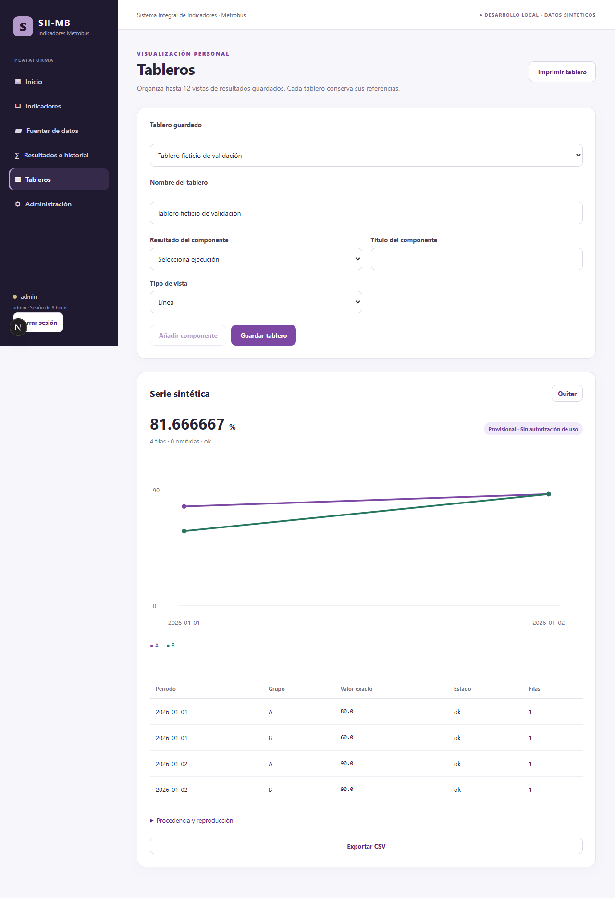
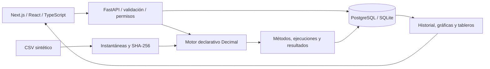

# SII-MB · Plataforma de indicadores configurables

**Aplicación full stack para definir indicadores, importar datos, versionar metodologías y producir resultados reproducibles.**

Next.js · React · TypeScript · FastAPI · Python · PostgreSQL · SQLAlchemy · Alembic · Playwright

> **Proyecto de portafolio en desarrollo activo.** Demostración con datos completamente sintéticos, basada en necesidades de análisis del transporte público. Las referencias a Metrobús describen el contexto de diseño; no implican aval institucional, un sistema oficial aprobado ni un despliegue productivo.

[Inicio local](docs/GETTING_STARTED.md) · [Pruebas verificadas](docs/VERIFICACION_V02.md) · [Motor de cálculo](docs/MOTOR.md) · [Arquitectura y alcance](docs/PLAN_IMPLEMENTACION.md) · [Seguridad](SECURITY.md)



## Qué demuestra

- **Ingeniería full stack:** interfaz responsiva y API modular con contratos tipados, validación y persistencia.
- **Configuración dinámica:** indicadores, dimensiones y métodos creados desde la aplicación, sin programar cada indicador.
- **Motor analítico seguro:** conteos, sumas, promedios, razones y expresiones compuestas mediante operadores permitidos; sin ejecutar código aportado por usuarios.
- **Reproducibilidad y linaje:** fuentes CSV inmutables con SHA-256; métodos versionados; ejecuciones, parámetros y resultados históricos independientes.
- **Análisis visual:** series temporales, tablas, barras, rankings, comparativos, tableros personales persistidos, CSV e impresión.
- **Control de acceso:** sesiones, contraseñas con scrypt, roles y permisos por indicador y fuente, revocación y auditoría.
- **Calidad y operación:** migraciones, pruebas automatizadas, recuperación de respaldos y comprobación de concurrencia.

## Arquitectura



Las identidades de indicadores, metodologías, fuentes y ejecuciones son entidades distintas. Una nueva fórmula genera otra versión, y una nueva carga genera otra instantánea: los resultados anteriores conservan su procedencia. El cálculo diferencia faltantes, selección vacía y denominadores cero.

## Evidencia de funcionamiento

Resultados de la verificación local del 18 de octubre de 2026:

| Comprobación | Resultado |
|---|---|
| Backend con PostgreSQL 17.11 | **38 pruebas aprobadas** |
| Backend con SQLite | **35 aprobadas**, tres casos específicos de PostgreSQL omitidos |
| Navegador Edge con PostgreSQL | **3 flujos aprobados** |
| Tipado TypeScript y compilación Next.js | Aprobados |
| Revisión estática Python y formato de interfaz | Aprobados |

El flujo de navegador parte de un catálogo vacío, importa CSV, crea un indicador, configura y modifica su metodología, verifica el cálculo, exporta, guarda un tablero y comprueba los permisos de una cuenta de consulta. Las pruebas adicionales recuperan un respaldo en otra base y verifican doce altas concurrentes sin pérdida de permisos.

Estas cifras corresponden a ejecuciones documentadas, no a insignias de CI. El workflow de GitHub es manual y no se ha presentado como ejecutado. [Informe y límites de verificación](docs/VERIFICACION_V02.md).

## Ejecutarlo localmente

Requisitos: Python 3.12, Node.js 24 y npm. En Windows, desde la raíz:

```powershell
.\scripts\start-local.ps1 -Install -CreateAdmin
```

La cuenta inicial solicita una contraseña propia. No hay credenciales predeterminadas para la aplicación. Abre **http://127.0.0.1:3000**.

También están documentados el [arranque manual y Docker Compose](docs/GETTING_STARTED.md). PostgreSQL se probó de forma nativa; los contenedores Compose están preparados, pero aún no se han ejecutado en el entorno de verificación.

```powershell
.\scripts\verify.ps1
```

## Estado y próximos pasos

El núcleo funcional local está implementado y probado. Continúan pendientes la ejecución de contenedores, pruebas generales de carga, integración de identidad institucional y controles avanzados de gobernanza. Los resultados de demostración son provisionales y no autorizan decisiones institucionales. Los conectores futuros podrán incorporarse mediante adaptadores de confianza.

El repositorio no contiene datos institucionales reales, bases de aplicación ni secretos operativos. Las cadenas de contraseña que aparecen en los tests son exclusivamente fixtures sintéticos, no credenciales de un servicio publicado.

## English summary

**Configurable indicator management and reproducible analytics platform.** Full-stack application built with Next.js, TypeScript, FastAPI and PostgreSQL, featuring immutable CSV snapshots, a safe declarative calculation engine, methodology versioning, historical results, dashboards, scoped access control and audit logs. Verified locally with synthetic data; active development, not an official institutional deployment.

## Documentación y uso del código

[Guía de ejecución](docs/GETTING_STARTED.md) · [Operación](docs/OPERACION.md) · [Diseño y trazabilidad](docs/TRAZABILIDAD_DEC.md) · [Contribuciones](CONTRIBUTING.md)

El código se publica para evaluación técnica y portafolio. No se ha otorgado una licencia de reutilización mediante este cambio de visibilidad; cualquier uso fuera de las facultades de la plataforma deberá contar con la autorización correspondiente. Las dependencias conservan sus propias licencias.
